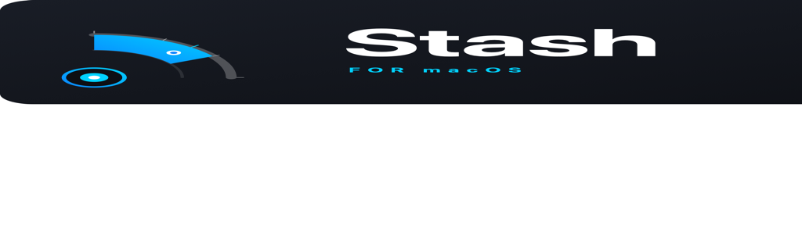
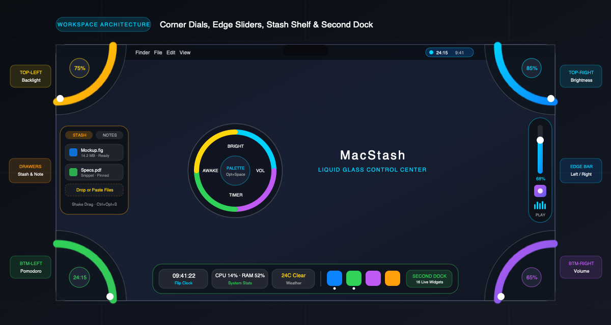

<p align="center">
  <picture>
    <source media="(prefers-color-scheme: dark)" srcset="Design/Logo/exports/brand/stash_lockup_dark.png">
    <source media="(prefers-color-scheme: light)" srcset="Design/Logo/exports/brand/stash_lockup_light.png">
    
  </picture>
</p>

<p align="center">
  <strong>Tactile Hidden Controls &amp; Smart Corner Dials for macOS</strong><br/>
  <em>Zero-pixel hot corner gestures, multi-monitor hardware brightness, tactile audio routing, and Pomodoro focus timer.</em>
</p>

<p align="center">
  <a href="https://github.com/xt2201/macstash/releases/latest"></a>
  
  
  
  <a href="LICENSE"></a>
  
  
</p>

<p align="center">
  <a href="https://github.com/xt2201/macstash/releases/latest">
    
  </a>
</p>

<p align="center">
  <a href="#overview">Overview</a> &bull;
  <a href="#quadrant-architecture">Quadrant Architecture</a> &bull;
  <a href="#key-features">Key Features</a> &bull;
  <a href="#how-it-works">How It Works</a> &bull;
  <a href="#installation">Installation</a> &bull;
  <a href="#permissions--privacy">Privacy &amp; Permissions</a> &bull;
  <a href="#shortcuts">Shortcuts</a> &bull;
  <a href="#developer-guide">Developer Guide</a> &bull;
  <a href="#documentation">Documentation</a>
</p>

---

## Overview

**MacStash** is a lightweight, background utility for macOS that reinvents screen corners and borders as zero-pixel tactile interaction zones. Based on Fitts's Law, the physical corners of your display represent infinite target zones—meaning you can flick your mouse to any corner without needing to aim.

Tucked invisibly at the screen boundary, MacStash blooms interactive radial dials into view when your pointer dwells at a corner. Drag along the arc or flick your trackpad scroll wheel to adjust display brightness, tune keyboard backlighting, scrub master audio volume, or kick off a Pomodoro focus sprint.

<p align="center">
  
</p>

---

## Quadrant Architecture

MacStash assigns high-frequency system controls to the four physical display vertices:

| Corner | Default Assignment | Technology &amp; Action |
|---|---|---|
| **Top-Left (TL)** | **Keyboard Backlight** | Direct macOS Ambient Light Sensor (ALS) control; smooth 0–100% illumination with one-click toggle. |
| **Top-Right (TR)** | **Display Brightness** | Multi-monitor hardware DDC/CI (I2C) for third-party external monitors + Apple Silicon native display brightness. |
| **Bottom-Left (BL)** | **Pomodoro Focus Timer** | Radial arc countdown (0–60 min) with round progression pips and satellite reset/skip micro-controls. |
| **Bottom-Right (BR)** | **Master Volume &amp; Route** | Real-time audio gain adjustment and immediate audio output device switching. |
| **Screen Edges** | **Edge Slider &amp; Drawers** | Symmetric Left/Right edge vertical slider (with Now Playing art &amp; visualizer) and Stash Shelf / Scratchpad drawers. |
| **Cursor / Floating Dock** | **Cursor Palette &amp; Second Dock** | `Option+Space` four-sector radial dial under cursor + multi-profile **Second Dock** (`Control+Option+D`) with 16 live widgets. |

---

## Key Features

### 1. Sculpted Liquid Glass Radial Corner Dials
- Invisibly docked at the screen corners with zero desktop clutter.
- **Screen Target Selection**: Actively choose which monitors display hot corners - Built-in Mac Screen only (default), External Displays only, or Both/All screens, with automatic desktop Mac fallback.
- **Apple Liquid Glass Optical Realism**: Multi-layer frosted refraction, dual-path specular bevel highlights (135° virtual light source), and dynamic caustic ambient color halos.
- **Tactical HUD Precision Instrument Hub**: Center action hubs engineered with studio-grade optical glass bezels, multi-color hierarchical SF Symbols, and precision micro-typography with tabular figures (`.monospacedDigit()`).
- **Mathematical Symmetry & 4-Quadrant Balance**: Perfectly aligned along the 45° diagonal axis of symmetry with uniform 19pt clearance to both adjacent screen borders, inner concentric guide arcs, and 21 symmetrical ticks with major indicators placed at 0%, 25%, 50%, 75%, and 100%.
- **Luminous Fluid Meniscus**: Active levels (Volume, Brightness, Keyboard, Timer) are rendered as glowing fluid inside a sculpted crystal arc with a curved droplet meniscus head and illuminated laser-etched tick marks.
- **Natural Two-Axis Trackpad Scrubbing**: Synchronized with macOS Natural Scrolling via `event.isDirectionInvertedFromDevice`. Glide two fingers UP or RIGHT on your trackpad to smoothly increase volume, brightness, backlight, or timer duration, or DOWN and LEFT to decrease.
- Drag along the radial arc or use vertical/horizontal trackpad scrolling for fluid adjustments.
- Instant collapse when the cursor departs the quadrant area.

### 2. Multi-Monitor Hardware Brightness (DDC/CI &amp; Native)
- Controls third-party HDMI and DisplayPort monitors directly via DDC/CI hardware I2C packets.
- Smooth fallback to Apple Native CoreDisplay services for built-in Retina panels and Pro Display XDR / Studio Display.
- **Synchronous Hardware Brightness Querying**: Physical Mac keyboard brightness adjustments (F1/F2 keys) are continuously synchronized in real-time without state drift, keeping hot corner dials 100% accurate.
- Synchronized multi-display dimming or independent per-display adjustment.

### 3. Tactile Pomodoro Focus Engine
- Visual countdown dial showing remaining session time as a sweeping luminous sector.
- Integrated round progression indicators showing completed vs. target focus intervals.
- Corner satellite micro-buttons for immediate one-click Session Reset and Interval Skip.
- Live ticking title in the macOS menu bar status item while running.

### 4. Master Audio, Real-Time Transport &amp; Seeking
- Instant volume scrubbing with linear perceived loudness scaling and real-time CoreAudio physical key sync.
- **Fine-Grained Audio Seeking & Transport**: Full scrubber bar, Skip Forward 10s (`goforward.10`), Skip Backward 10s (`gobackward.10`), and live timestamp readouts directly on both screen edge bars and corner dials.
- Rapid audio output device switcher directly from the corner popover.

### 5. The Liquid Docking Bay (Stash Drop Shelf) & Quick Scratchpad
- **Modular Enable/Disable**: Both Stash Shelf and Quick Scratchpad feature independent toggles (default: OFF) so screen edges remain completely clean and zero-resource until you choose to enable them.
- **Configurable Screen Edge**: Attach drawer utilities to either the Left Edge or Right Edge of your screen, matching your personal workflow and physical workspace.
- **The Stash Shelf**: The core namesake feature of MacStash. A sculpted liquid glass docking bay sliding smoothly from the screen edge to hold files, images, links, and text snippets when dragging across spaces, displays, or apps.
- **Silky-Smooth 120 FPS Performance**: Isolated row rendering (`StashItemCardView`) and in-memory icon caching (`StashIconCache`) eliminate LaunchServices disk I/O during mouse hover and scroll, guaranteeing locked 120 FPS fluid interaction.
- **Instant Zero-Copy Drag Out**: Items dragged from the shelf provide standard `UTType.item` file representations for immediate drag-and-drop to Finder folders, the Desktop, or third-party apps with full-card drag interaction.
- **True Clipboard File Copying**: The copy button writes real file objects (`NSURL`, `NSFilenamesPboardType`) to the pasteboard, enabling instant file pasting into Finder, Desktop, Mail, and Slack without dropping plain text paths.
- **Liquid Ripple Drop Aura**: Hovering a dragged file over the drop zone summons an animated pulsating liquid ripple wave that magnetically expands to receive items. A top drop banner guides drag-and-drop even over populated lists.
- **Elevated Glass File Tiles**: Stashed items rest on translucent frosted glass tiles with continuous squircle corners, 3D hover elevation, and crystal micro-action buttons.
- **Bidirectional Shake-to-Summon Gesture**: Wiggle or shake the mouse cursor horizontally or vertically while dragging any file, photo, or snippet to immediately summon the Stash Shelf at your cursor with tactile mechanical detents.
- **1-Click Launch from Edge Peek Handle**: Hover or click the subtle 44pt left-edge indicator to slide out the shelf without delay, with full protection against edge jitter or accidental collapse.
- **Double-Click to Launch**: Double-clicking any file, image, or link on Stash Shelf immediately launches it with the default macOS system app.
- **Zero-Footprint Background Pass-Through**: Floating edge panels strictly ignore mouse events when idle and center resting peek handles on a slim strip, guaranteeing 100% unimpeded clicks in underlying macOS apps (Finder sidebar, Safari tabs, Xcode editor, Terminal).
- **Outside-Click & Mouse-Exit Auto-Dismiss**: Moving the mouse out of the drawer area into the workspace automatically schedules a smooth auto-dismiss timer, while clicking outside collapses the shelf immediately and returns window focus cleanly to your active application. Drop operations stay safely active during drag sessions.
- **Immediate First-Mouse Interaction**: Every button (Clear All, Copy Path, Reveal in Finder, Remove, Close) triggers on the very first mouse-up with zero swallowed clicks.
- **Quick Drag Export & Copy All**: Drag stashed items back out to any application, email, or Finder folder anytime, or click "Copy All" to copy all file references to the clipboard at once.
- **Quick Scratchpad Drawer**: Ephemeral liquid glass writing slate with dynamic key window keyboard focus for immediate typing, glowing emerald rim, live word and character counters, automatic local persistence, and standard macOS keyboard shortcuts (`Cmd+A`, `Cmd+C`, `Cmd+V`, `Cmd+X`, `Cmd+Z`, `Esc`).

### 6. Keep Awake (Caffeine) Radial Dial
- Hardware-level macOS I/O Kit power assertions (`IOPMAssertionCreateWithName`) prevent display and system sleep during video exports, large downloads, or presentations.
- Radial presets: 15m, 30m, 1h, 2h, and Indefinite (∞) with tactile mechanical detent feedback.
- Quick status badge and one-click toggle in the macOS menu bar companion.

### 7. Cursor Radial Palette (for Ultrawide Displays)
- Press `Option + Space` to summon the 4-quadrant radial dials with per-sector progress rings directly centered at your mouse cursor.
- Hover any sector (Display Brightness, Master Volume, Focus Timer, Keep Awake) and **scroll two fingers** to adjust smoothly, click to toggle, or click outside / press `Esc` to dismiss.

### 8. Dual Edge Bars (Left &amp; Right) &amp; Dynamic Island Media Controller
- **Simultaneous Dual Edge Bars**: Enable and configure both Left and Right edge bars simultaneously (default: Both Sides), each with independent actions (e.g., Left for Brightness / Media Playback, Right for Volume).
- **Dynamic Island Horizontal Audio Expansion**: Hovering over the compact artwork capsule smoothly morphs it outward horizontally into a Dynamic Island widget featuring song title, artist, live audio visualizer, interactive scrubber bar, and 5-button transport controls, keeping the vertical Edge Bar height permanently compact.
- **Dedicated Media Player &amp; Audio Scrubber**: Standalone `mediaPlayback` action transforms the Edge Bar into a high-precision vertical audio scrubber and the Corner Dial into a tactile media jog wheel.
- Rides flush against your screen border with configurable actions in Settings (`Volume`, `Brightness`, `Keyboard Backlight`, `Pomodoro Timer`, `Keep Awake`, `Stash Shelf`, `Scratchpad`, `Media Player & Audio Scrubber`) and 120Hz ProMotion vertical drag/scroll smoothness.
- **Extreme Edge &amp; Dwell Triggering**: Requires moving cursor cleanly to the physical edge (`minX` or `maxX`) with an intentional dwell delay, preventing accidental triggers near app scrollbars.
- **Universal Now Playing Media Controller**: When configured for Volume, reveals an integrated vertical media controller right below the slider with live album artwork, a 5-bar rhythm audio visualizer (automatically idle-gated when overlays are hidden), and vertical transport controls across browsers and native players.
- **Two-Finger Edge Scrubbing**: Seamlessly scrub audio playback (up/right = forward, down/left = backward) inside the expanded Dynamic Island, or hover the outer-edge Volume icon to switch both vertical and horizontal two-finger swipes to system volume adjustment.

### 9. Tactile Detents &amp; Mechanical Acoustics
- **Trackpad Detents**: Emits crisp physical ticks via `NSHapticFeedbackManager` with configurable Light / Medium / Strong intensity as the rotary dial steps through values.
- **Acoustic Feedback**: Low-latency mechanical click sound effects mimicking high-end rotary hardware dials.

### 10. Context-Aware Application Profiles
- Detects the frontmost active application and dynamically reconfigures corner dials and edge actions (add profiles effortlessly via Running Applications or `/Applications` picker in Settings &gt; Hot Corners).

### 11. Menu Bar Control Center &amp; Split-Sidebar Settings Studio
- **296pt Menu Bar Control Center**: Features structured cards for Active Context &amp; Profile, Pomodoro countdown &amp; controls, cached multi-monitor brightness sliders, master audio + keyboard backlight, 6 one-click module toggles, and direct links to Settings (`Command+,`) and User Guide (`Command+?`).
- **8-Category Split-Sidebar Settings**: Interactive Desktop Screen Map, Interactive Liquid Glass Studio (test corner dials live on Midnight/Daylight backdrops with synchronized Light/Dark window themes), Keycap Shortcut Recorders with `ShortcutValidator` conflict checks, Max/Min display clamps + quick presets, and Markdown User Guide viewer.

### 12. Second Dock with 16 Live Interactive &amp; Configurable Widgets
- **Auxiliary Second Dock**: An independent live widget and app launcher dock (`Control+Option+D`) running alongside your native macOS Dock with running application dot indicators and persistent widget state.
- **16 Native Local Widgets with Per-Widget Customizer**:
  1. *Clock*: Digital, analog dial face, or flip clock with seconds, 24h mode, and multi-timezone world clock configuration.
  2. *Date*: Calendar badge with configurable weekday and full month name display.
  3. *Weather*: Open-Meteo conditions &amp; forecast with zero API keys, live city search geocoding, and °C/°F unit toggle.
  4. *Now Playing*: Background-parsed playback controls, track info, and freshness validation for Apple Music and Spotify.
  5. *Calendar*: Upcoming events auto-refreshing via `EKEventStoreChanged`, countdown, and 1-click Join buttons for Zoom, Google Meet, Teams, and Webex.
  6. *Reminders*: Due tasks checklist with instant EventKit sync, quick-add, and 1-tap completion.
  7. *System Stats*: Accurate real-time delta CPU (`CPUTickSample`), RAM utilization, battery state, and configurable sensor toggles.
  8. *Pomodoro*: Monotonic focus timer sprints, custom focus/break durations, and alerts.
  9. *Search, Clipboard, Quick Note, File Shelf, Screenshot, Color Picker, Unit Converter &amp; Bookmarks*: Complete suite of productivity dock utilities with customizer sheets (`WidgetConfigSheet`).
- **5 Layout Placements &amp; Smooth 1:1 Floating Drag**: Fixed Bottom (positioned cleanly above the native macOS Dock), Floating Window with 1:1 screen-tracked drag handle, Fixed Top, Fixed Left, and Fixed Right.
- **Smart Edge Triggers &amp; Glass Styling**: Independent Auto-Hide, Fullscreen hiding, and Window Hover fade triggers; Adaptive Light Glass, Dark Glass, Liquid Glass, and Clear themes; plus searchable 16-widget gallery.

---

## How It Works: Fitts's Law &amp; Zero-Pixel Hit-Zones

In human-computer interaction, **Fitts's Law** states that the time required to rapidly move to a target area is a function of the ratio between the distance to the target and the width of the target:

$$\text{MT} = a + b \log_2 \left( \frac{2D}{W} \right)$$

Because the macOS mouse cursor cannot travel beyond the physical boundary of the screen, the display edges and corners effectively have an **infinite target width** ($W = \infty$). This makes screen corners the fastest, most effortless targets on the entire screen:

1. **Zero Acquisition Cost**: You can flick your mouse toward a corner with maximum physical velocity without overshooting.
2. **Dwell Threshold Protection**: MacStash prevents accidental activations with an adjustable dwell delay (default `0.20s`), ensuring normal window management gestures are never intercepted.
3. **Continuous Scrubbing**: Once bloomed, circular arc trigonometry tracks cursor rotation around the corner vertex, granting 360-degree precision control.

---

## Installation

### Method 1: Direct DMG Download (Recommended)
1. Download the latest universal disk image: **[MacStash-v2.16.0.dmg](https://github.com/xt2201/macstash/releases/latest)**.
2. Open the disk image and drag **MacStash** into your `Applications` folder.
3. Launch MacStash from Launchpad, Spotlight, or `Applications`.

> [!NOTE]
> If macOS displays an unsigned developer notice on first launch, open **System Settings &gt; Privacy &amp; Security** and click **Open Anyway**, or run:
> ```bash
> xattr -d com.apple.quarantine /Applications/MacStash.app
> ```

### Method 2: Automatic In-App Updates (Sparkle 2)
MacStash includes built-in background updates powered by **Sparkle 2**. Updates are cryptographically verified using Apple CryptoKit Ed25519 public signatures before installation.
- Check for updates anytime via the Menu Bar &gt; **Preferences &gt; About &gt; Check for Updates**.

---

## Permissions &amp; Privacy

MacStash is committed to absolute user privacy. It operates **100% locally and offline**. It collects zero analytics, performs zero network tracking, and requires no account or cloud registration.

| Permission | System Privilege | Purpose in MacStash | Network Activity |
|---|---|---|:---:|
| **Accessibility** | `AXUIElement` | Used to anchor floating dial overlays at physical display corners and track cursor proximity. | **None (Offline)** |
| **Input Monitoring** | `CGEvent` tap | Detects corner hover gestures and global hotkey shortcuts. Does not record keystrokes or text. | **None (Offline)** |
| **Apple Events** | `NSAppleScript` | Coordinates hardware brightness, audio levels, and active application detection. | **None (Offline)** |
| **Calendars & Reminders** | `EventKit` | Reads upcoming events and todos for Calendar and Reminders widgets (100% on-device). | **None (Offline)** |

---

## Shortcuts &amp; Settings

| Shortcut | Action | Scope |
|---|---|---|
| `Option + Space` | Bloom Cursor Radial Palette | Global |
| `Control + Option + S` | Toggle Stash Drop Shelf | Global |
| `Control + Option + D` | Toggle Second Dock | Global |
| `Command + 1..8` | Switch Active Second Dock Profile | Global |
| `Control + Option + N` | Toggle Quick Scratchpad | Global |
| `Option + S` | Toggle Screen Hot Corner Dials | Global |
| `Command + ,` | Open MacStash Settings Window | Global / In-App |
| `Command + W` | Close Active Settings or Guide Window | In-App |
| `Command + ?` | Open In-App Markdown User Guide | Global / In-App |
| `Command + Q` | Quit MacStash completely | In-App |
| `Esc` | Dismiss Open Cursor Palette, Shelf, or Scratchpad | Overlay |

Record custom global hotkeys with live `ShortcutValidator` conflict detection, adjust dwell delays, pick appearance themes, and explore the Interactive Screen Map anytime in **Settings &gt; Shortcuts / Hot Corners**.

---

## Developer Guide

### Prerequisites
- macOS 14.0 (Sonoma) or newer (Sequoia fully supported).
- Swift 6 compiler toolchain (`xcrun swift --version`).
- Xcode Command Line Tools (`xcode-select --install`).

### Build &amp; Test Workflow

```bash
# 1. Clone repository
git clone https://github.com/xt2201/macstash.git
cd macstash

# 2. Run unit and domain test suite
make test

# 3. Regenerate all brand assets, ICNS, and vector PDFs
./Scripts/render_icons.sh

# 4. Compile release binary and package distribution DMG
./Scripts/build_dmg.sh
```

The output DMG and signed Sparkle ZIP archive will be placed in `dist/`.

---

## Documentation

Full bilingual guides and troubleshooting documentation are available in the repository:
- **[English Guide](Docs/Guide/en/01_getting_started.md)**: Getting Started, Display Brightness, Pomodoro Timer, Troubleshooting, Settings, Shortcuts, FAQ.
- **[Vietnamese Guide](Docs/Guide/vi/01_getting_started.md)**: Hướng dẫn bắt đầu, Độ sáng màn hình, Đồng hồ Pomodoro, Xử lý sự cố, Cài đặt, Phím tắt, FAQ.
- **[Brand &amp; Logo Rationale](Design/Logo/04-rationale.md)**: Visual identity principles, geometry specifications, and color palette.

---

## License

MacStash is open-source software licensed under the **[MIT License](LICENSE)**. All vector designs and brand assets are original works subject to the guidelines in `Design/Logo/LICENSES.md`.
