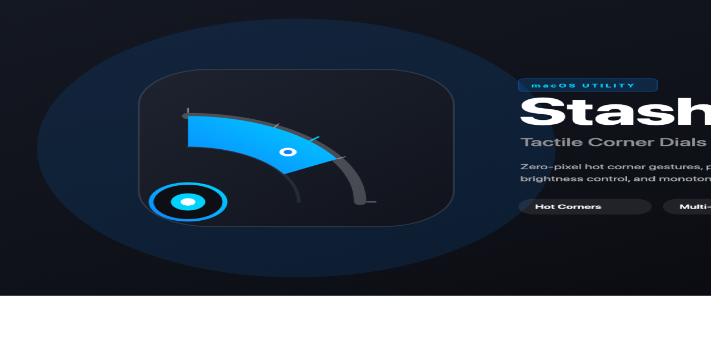

# MacStash

<p align="center">
  
</p>

<p align="center">
  <strong>Tactile Hidden Controls &amp; Smart Corner Dials for macOS</strong><br/>
  <em>Zero-pixel hot corner gestures, multi-monitor hardware brightness, and Pomodoro focus timer.</em>
</p>

<p align="center">
  
</p>

---

## Features

- **Quarter-Circle Corner Dials**:
  - Quarter-circle radial dials tucked invisibly into the four screen corners.
  - Gently blooms into view when the mouse dwells at the corner (0.2s delay, 5-8pt tight hit-zone).
  - Drag along the arc or use trackpad scroll to adjust values.
  - **Top-Left (TL)**: Keyboard Backlight brightness.
  - **Top-Right (TR)**: Per-Monitor Display Brightness (DDC/CI and Apple Native Display Services).
  - **Bottom-Left (BL)**: Pomodoro Focus Timer with live radial countdown.
  - **Bottom-Right (BR)**: Master Audio Volume & Output Device switching.
- **Hidden Dock Shelf**:
  - Lives discreetly on the screen border.
  - Slides out smoothly when hovering the edge.
  - Pinned apps with macOS dock magnification effect on hover.
  - Includes an instant Quick App Launcher with search.
- **Tactile Feedback**:
  - **Trackpad Haptics**: Uses `NSHapticFeedbackManager` to emit subtle, satisfying detent ticks as dials rotate through each notch.
  - **Mechanical Sound FX**: Low-latency mechanical click sounds mimicking physical rotary knobs.
- **Context-Aware App Profiles**:
  - Automatically detects frontmost active apps and switches corner dial assignments dynamically.
- **Menu Bar Utility**:
  - Runs in the background as a lightweight agent (`LSUIElement = true`).
  - Native monochrome template image indicator with automatic Pomodoro active state.
  - Full-featured Preferences window (`Command + ,`).

---

## Brand Identity & Icon Design

The visual identity of Stash is defined in `Design/Logo/`:
- **Concept**: *The Radial Corner Bloom* - An anchor pin positioned at the physical screen corner vertex, paired with a sweeping 60-degree precision radial dial arc and mechanical detents.
- **Liquid Glass Architecture**: Layered vector SVG specifications (`background.svg`, `foreground.svg`, `mono.svg`) adhering to Apple Human Interface Guidelines for macOS Sequoia and Icon Composer.
- **Color Palette**: Obsidian Slate (`#191D26`), Deep Charcoal (`#0D0F14`), Precision Cyan (`#00D2FF`), Electric Azure (`#0A84FF`), and Platinum White (`#FFFFFF`).
- **Reproducible Pipeline**: All app icons (`.icns`), menu bar template images (`@1x`, `@2x`, `@3x`), and vector PDFs are automatically generated via `scripts/render_icons.sh`.

---

## Getting Started

### Prerequisites

- macOS 13.0 (Ventura) or newer (macOS 14 Sonoma and macOS 15 Sequoia fully supported).
- Swift 5.9+ / Swift 6 compiler toolchain.
- Xcode Command Line Tools.

### Building and Running

1. **Clone the repository**:
   ```bash
   git clone https://github.com/macstash/macstash.git
   cd macstash
   ```

2. **Generate brand assets and icons**:
   ```bash
   ./scripts/render_icons.sh
   ```

3. **Run tests**:
   ```bash
   swift run MacStashTestRunner
   ```

4. **Build and package DMG installer**:
   ```bash
   ./scripts/build_dmg.sh
   ```

The packaged DMG disk image will be placed at `MacStash-v2.0.0.dmg`.

---

## License

This project is licensed under the MIT License. See `LICENSE` and `Design/Logo/LICENSES.md` for full copyright and font usage details.
